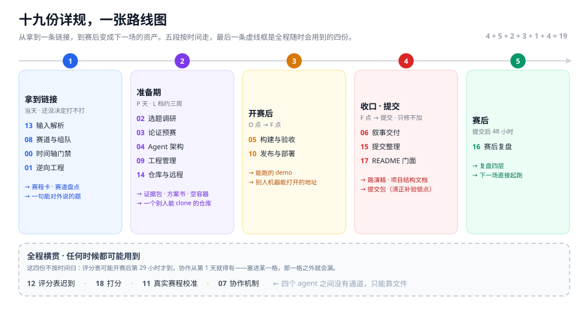
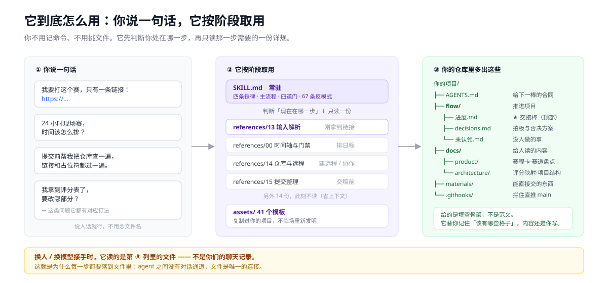
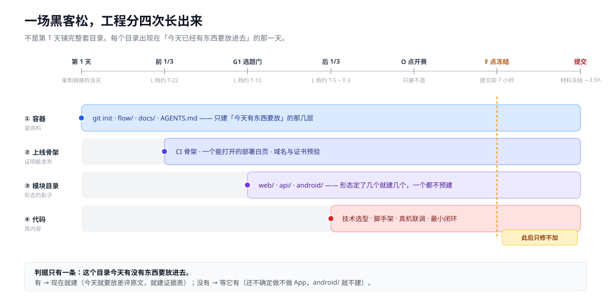
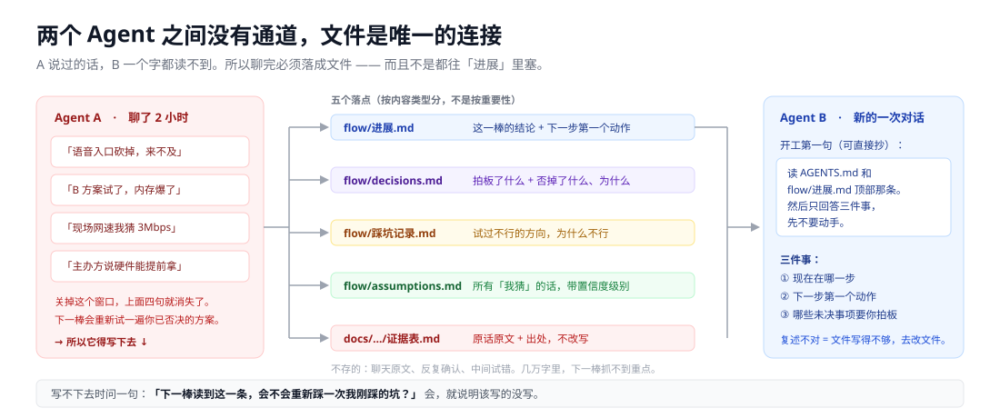
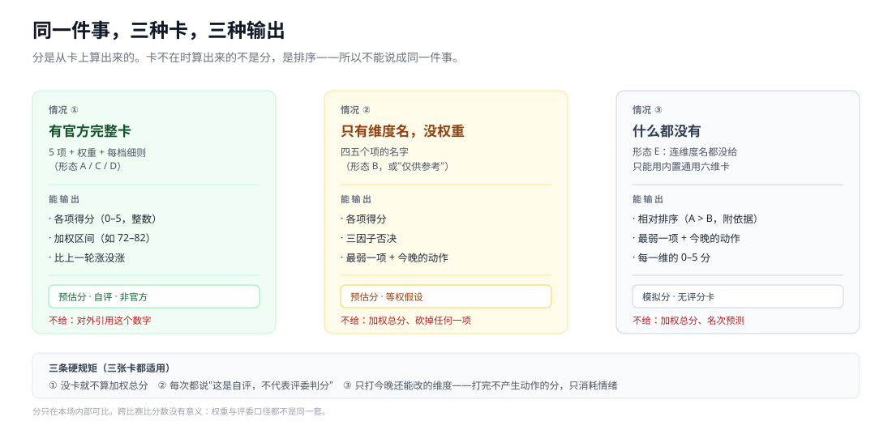
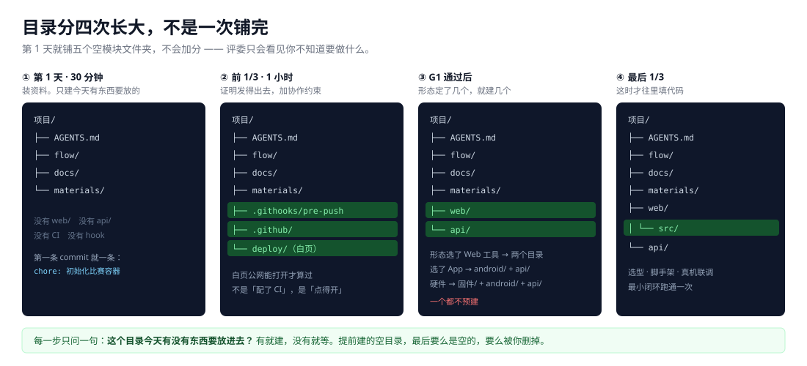
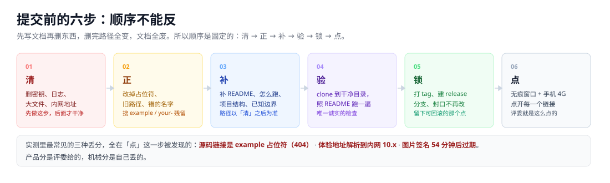
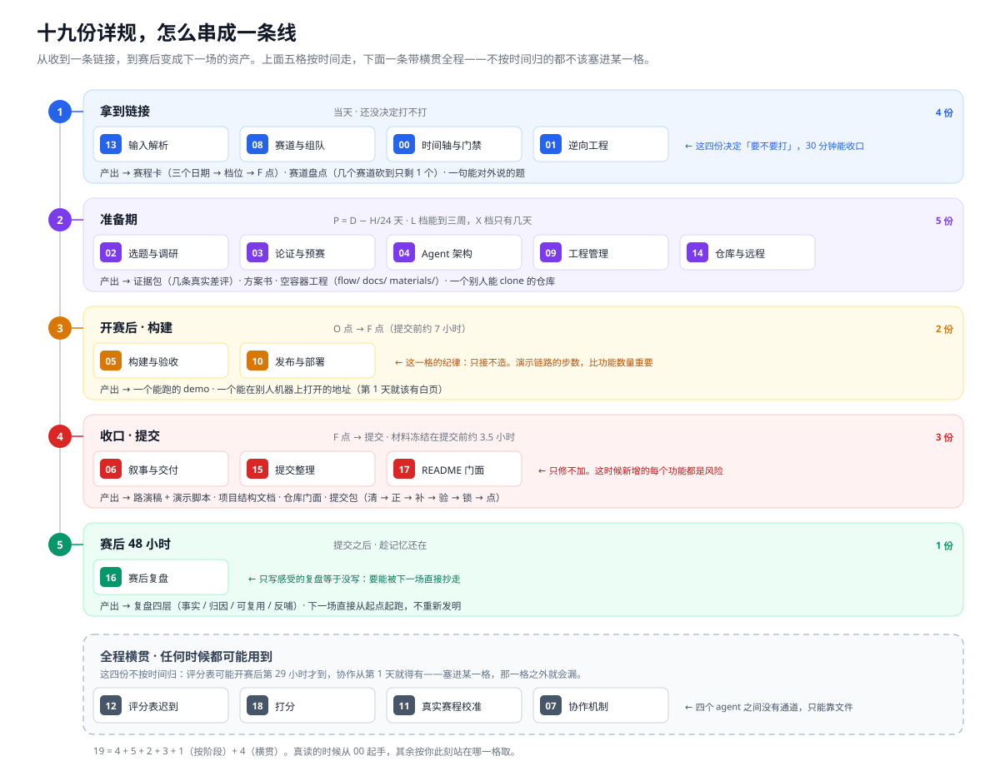

# hackathon-flow


### 黑客松从「报名」到「领奖」的工程脚手架

**不是教程，是装进项目里就能跑的骨架**——19 份详规 + 42 个模板 + 7 份填过的示例，丢给 Claude Code / Codex 说句话就能开工。



**整张路线图**，点开可放大。五段从左到右按时间走（报名判断 → 准备期 → 开赛后 → 收口 → 赛后），每段写着"该读哪几份、读完手里多出什么"；最下面那条虚线框是**全程随时会用到的四份**，它们不属于任何阶段。图里的编号就是 `references/` 的文件号。

> **它解决的是一个很具体的场面**：你已经报名了，只剩 19 天、3 个人，资料全散在群聊里，上一场打到凌晨四点还在改 PPT。
> 这套流程把"来不及"提前到还能救的时候——**第 1 天建容器，第 10 天决定不做什么，最后 7 小时冻结系统，现场只接不造。**

下面这张表是"你现在最可能卡在哪"，对号入座比从头读快得多：

| 你的处境 | 它当场给你的动作 |
|---|---|
| 第一次打，完全不知道从哪下手 | 30 分钟建好骨架（`flow/` `docs/` `AGENTS.md`），第 1 天就有地方放东西 |
| 时间根本不够，越到最后越乱 | 先用三个日期算出档位（L/M/S/X/T/Z）再排期，不抄别人 42 天赛程 |
| 评分标准赛后才给，前面白做 | 五种到达形态各有打法，90 分钟重对齐，**不重写** |
| 最后一天全队互相覆盖代码 | 三层提交约束 + F 点冻结 + 材料冻结，两条线不打架 |
| 换个 Agent 就接不上 | 聊天内容落五个文件，A 的结论 B 读得到，`进展.md` 顶部就是交接棒 |
| 打完就忘，下一场从头再来 | 四层复盘（事实 / 归因 / 可复用 / 反哺），直接变下一场的起点 |

**一行装上**（装到你在用的那个 Agent 的 skills 目录）：

```bash
git clone https://github.com/fqyy360t/hackathon-flow.git ~/.claude/skills/hackathon-flow     # Claude Code
git clone https://github.com/fqyy360t/hackathon-flow.git ~/.codex/skills/hackathon-flow      # Codex
git clone https://github.com/fqyy360t/hackathon-flow.git ~/.workbuddy/skills/hackathon-flow  # WorkBuddy
```

装完说这句话就能开始：**"我要打 XX 黑客松，只有这条链接：<url>。帮我看看值不值得打，从哪开始。"**

**它管流程、判据和研究方法，不管你的业务内容**——市场数据、技术选型、那些访谈本身是你的；什么时候该判断什么、访谈该问哪 12 个问题、判断完写在哪、时间不够先砍什么，是它的。

**它也不保证任何结果。** 这是个人经验的整理，不是方法论认证；能减少的是"因为流程乱而输"，减少不了"因为题选错、评委不买账"的风险。完整声明见文末 [§免责声明](#免责声明)。

---

## 从哪里开始阅读

| 你是谁 / 想干什么 | 读这个 | 花多久 |
|---|---|---|
| **完全不知道这是啥、怎么用** | 本文件 §一（怎么装、说什么话）+ §二（一场比赛从头走一遍） | 12 分钟 |
| 判断这玩意靠不靠谱 | 本文件 + [`SKILL.md`](SKILL.md) 末尾的 **77 条反模式** | 10 分钟 |
| 手上已经有一条比赛链接，今天就要动 | [`references/13-输入解析与赛道盘点.md`](references/13-输入解析与赛道盘点.md) → 30 分钟内建好容器 | 30 分钟 |
| **赛前要写商业分析、用户分析、产品定位** | [`references/02-选题与调研.md`](references/02-选题与调研.md)：**商业**（八点提纲 → 价值链五角色 → PEST+AIPL → 定位三问 → 三本账 → 规模口径 → 竞品）· **用户**（访谈 12 问 → 画像卡 → 旅程走查）· **证据**（七字段证据卡） | 30 分钟 |
| 想看它凭什么这么判断（证据在哪） | [`references/11-真实赛程校准.md`](references/11-真实赛程校准.md)：一场 42 天赛程的逐日还原 | 15 分钟 |
| 想看填好的文件长什么样 | [`examples/48h-demo/`](examples/48h-demo/)：一场虚构的 48h 比赛，七份文件真的填过 | 20 分钟 |
| 想先给自己打个分，看离获奖差多远 | 本文件 §四下半 + [`references/18-打分与模拟评分.md`](references/18-打分与模拟评分.md) | 10 分钟 |
| 想自己翻详规，但不知道读哪份 | 本文件 **§9.1**：先看那张全景图，再查十九行索引 | 2 分钟 |
| 想改它 / 二次开发 | [`SKILL.md`](SKILL.md) 的目录树 + 反模式编号规范 | — |

---

## 一、装上，然后说第一句话

### 1.1 两种装法，选一个

**A. 作为 Agent Skill**（Claude Code / Codex / WorkBuddy / 任何读 `skills/` 目录的工具）

```bash
git clone https://github.com/fqyy360t/hackathon-flow.git ~/.claude/skills/hackathon-flow
# Codex 用 ~/.codex/skills/，WorkBuddy 用 ~/.workbuddy/skills/
```

目录名建议保持 `hackathon-flow`（与 `SKILL.md` 的 `name` 字段一致，部分工具会校验）。

**同时用多个 Agent 时，别复制三份**——复制出来的会各自变旧。装一份，另外两处建目录联接（Windows 下 `mklink /J`，macOS/Linux 用 `ln -s`），`git pull` 一次三处同步：

```bash
mklink /J "%USERPROFILE%\.claude\skills\hackathon-flow" "%USERPROFILE%\.workbuddy\skills\hackathon-flow"
```

**B. 只用模板，不装 skill**

```bash
cp -r assets/flow assets/docs assets/materials 你的项目/
cp -r assets/.githooks assets/scripts 你的项目/ && sh scripts/install-hooks.sh
```

`.githooks/pre-push` 会拦住直推 `main`，紧急通道是 `ALLOW_MAIN_PUSH=1 git push origin main`。

> **Windows 注意**：仓库根有 `.gitattributes` 强制脚本 LF。如果你的项目没有，`pre-push` 被 checkout 成 CRLF 会让 sh 报 `\r: command not found`，约束**静默失效**。

### 1.2 装好之后，你只要说人话

不用记文件名、不用挑命令。它先判断你处在哪一步，再只读那一步需要的一份详规。



**三句能直接抄的话**（覆盖 90% 的第一次使用）：

```
① 我要打 XX 黑客松，只有这条链接：<url>。帮我看看值不值得打，从哪开始。
② 读 AGENTS.md 和 flow/进展.md 顶部那条，只回答三件事：现在在哪一步、
   下一步第一个动作、有哪些未决事项要拍板。先不要动手。
③ 评分表拿到了，帮我算一下缺口、冗余、薄弱，出一张手术单。
```

**它会反过来问你三件事**（建远程仓库之前）：

| 它问 | 默认 | 为什么问 |
|---|---|---|
| 要不要推远程仓库？ | 要 | 有些赛只收 zip；不想留公开痕迹也可以不推 |
| 仓库叫什么名字？ | `<赛事缩写>-<产品名>` | **定了不改**——改名会让已提交的链接 404 |
| 公开还是私有？ | **公开** | 只有规则写明保密/成果归属才选私有。公开还有一个好处：免费拿到服务端分支保护 |

**它不会做的三件事**：不会覆盖你已有的文件（缺啥补啥）；不会替你判断业务；不会一次给你铺满五个空模块目录。

### 1.3 装完先别急着铺满

第一次用完，你应该只多出这些：

```
你的项目/
├── AGENTS.md          给下一个 agent 的合同
├── flow/              推进项目（charter / plan / 进展 / decisions / 未认领 …）
├── docs/              给人读的内容（赛程卡 / 赛道盘点 / 评分映射表 …）
├── materials/         能直接交出去的文件
└── .githooks/ .github/    拦住直推 main（第 1 天只有你一个人，但第二天会有人进来）
```

**没有 `web/` `api/` `android/`。** 那些等 G1 定了产品形态再建——提前建的空文件夹，评委看得见。

---

## 二、一场 48 小时比赛，从头走一遍

先把时间轴摊开——**工程的四层分别长在哪个时点**，为什么不能在第 1 天就铺满：



下面是一场**虚构的**比赛（队伍、产品都是编的），但每份文件的格式、判断顺序、数字口径都是真的。完整示例在 [`examples/48h-demo/`](examples/48h-demo/)。

| 项 | 值 |
|---|---|
| 赛制 | 48 小时 · 线上开发 + 最后 3 小时现场路演 |
| 拿到链接 | 2026-10-27 → 提交截止 2026-11-15 09:00 |
| **算出来的档位** | D=19 天，H=48h → **P=17 天 → M 档** |
| **算出来的 F 点** | 11-15 02:00 → 落在 22:00–06:00 → **前移到 11-14 22:00** |
| 评分表 | 赛前只有维度名，**开赛后 29 小时**才给完整细则 |

### 2.1 第 1 天：30 分钟建容器

**你做什么**：把链接丢过去，回答那三个仓库问题。
**它做什么**：抽三个日期 → 列七个必问 → `git init` + 铺 `flow/` `docs/` 空壳 → 一条 commit。

**13 个时点，这场比赛的全程长这样**：

| 日期 | 距提交 | 做了什么 | 仓库里多了什么 |
|---|---|---|---|
| 10-27 | T-19 | **当天 30 分钟建容器** | `flow/` `docs/` `AGENTS.md` + 第一条 commit |
| 10-28~29 | T-18~17 | 抽三个日期、判主办方动机、盘 2 个赛道 | `赛程卡.md` `赛道盘点.md` |
| 10-30 | T-15 | 报名（名额 120 已报 96）+ 定核心二人 | `team.md` |
| 10-31~11-03 | T-14~11 | S0 逆向：只有维度名 → 按等权假设建表 | `评分映射表.md` v1（评分项空着） |
| 11-04 | T-10 | 白页上线（暴露了域名要备案）+ 装 pre-push | `deploy/` `.githooks/` |
| 11-05 | T-9 | **G1 选题门**：7 条差评收敛到一个题 | `证据表.md` 产品与功能清单 |
| 11-06~09 | T-8~5 | S3 预埋：链路跑通、真机联调（M 档不砍） | `web/` `api/` 骨架 |
| 11-10 | T-4 | **G2 契约冻结** | `契约冻结.md` |
| 11-13 09:00 | O 点 | 开赛，只接不造 | — |
| 11-14 14:00 | O+29h | **评分表来了** → G3.5 重对齐 | `评分映射表.md` v2 + `decisions.md` D-06 |
| 11-14 22:00 | **F 点（前移）** | 功能冻结 + `release/f-point` tag | — |
| 11-15 05:30 | −3.5h | 材料冻结：讲稿 / PPT / 视频定稿 | `materials/` |
| 11-15 09:00 | 提交 | 六步清整 + 无痕窗口点链接 | `README.md` 定稿 |

### 2.2 四个切片：最难的四件事，实际是怎么过去的

**切片 ① 赛程卡：三个日期怎么变成一张日程**

```
D = 11-15 − 10-27 = 19 天
H = 48h
P = 19 − 2 = 17 天        → M 档（14–24 天）
F 点 = 提交 − 7h = 11-15 02:00
       02:00 在 22:00–06:00 禁改时段 → 前移到 11-14 22:00
材料冻结 = 提交 − 3.5h = 11-15 05:30
```

这三行推出三个决定：**不做预赛文档**（赛程里没有"提交材料→等通知"，省下的 3 天全投 S3）、**硬件当天才发，所以接口必须可替换**、**F 点 22:00 反推出"评分表最晚 14:00 到手还能救"**。

> F 点不只是"停止加功能"，它同时是**评分表最晚到达时间**的算法。这条在 [`赛程卡.md`](examples/48h-demo/docs/product/赛程卡.md) §五。

**切片 ② 评分表开赛后 29 小时才到：先算冗余，再算缺口**

| 差集 | 算出来什么 | 动作 | 花多久 |
|---|---|---|---|
| **冗余**（有内容，不服务任何项） | 语音播报 2.5h、团队介绍第二屏 2h | 砍掉，不进演示路径 | 0 |
| **缺口**（有评分项，没内容） | 演示项要求"无外网可跑"，我们全靠云端 | 加离线缓存（唯一 L3 改动） | 4h |
| **薄弱**（高权重只有弱证据） | 单位经济模型只有 D 级 | 补分母与口径 → C 级 | 1h |

砍冗余省下 4.5h，正好够补两个缺口。**这个顺序不能反**：先补缺口会让你用掉全部时间，然后再也没力气砍冗余。

**否决的方案也写下来了**：「把 OCR 换成纯本地模型」——12 小时以上，等于弃赛。不写下来，下一棒会重新想一遍。
见 [`decisions.md` D-06](examples/48h-demo/flow/decisions.md)。

**切片 ③ 换人接手：文件是唯一的通道**



A 说过的话 B 一个字都读不到。所以聊完要按类型落到五个地方——**只写"进展"是不够的**，它能说"做了什么"，说不出"否决了什么"，而后者才是下一棒最需要的。

**怎么做**：A 收工写一条 → 整条贴回对话 → 你复制给 B → B 先复述三件事再动手。复述不对 = 文件写得不够，去改文件，不要口头补。

**切片 ④ 没有评分卡时，怎么给自己一个数**

同一场项目打了三次分，三次手上拿的东西不一样：

| 时点 | 手上有 | 能输出什么 | 为什么只能输出这个 |
|---|---|---|---|
| 10-29 选方向 | **什么都没有** | **只排序**：A > B（痛点 4:2、记忆点 4:2） | 权重未知，加权总分是"假的精确" |
| 11-06 拿到维度名 | 5 个名字，无权重 | 各项分 + **三因子否决** | 等权假设下不许砍任何一项 |
| 11-14 卡到手 | 5 项 + 权重 + 细则 | **77 分（区间 72–82）**，标"自评 · 非官方" | 权重是官方的，可以算；但名次算不出 |

11-06 那次最关键：**哇时刻只有 1 分 → 一票否决**，之后 8 小时全投在"让系统承认自己不确定"（现场故意拍一张模糊照片，给出重拍提示），而不是去补商业落地。
**如果那一轮按"最弱维度"去补商业，这个项目就没有 demo 记忆点了。** 见 [`打分记录.md`](examples/48h-demo/docs/architecture/打分记录.md)。

### 2.3 空白模板 vs 填好的样子

新手最常卡在"我知道该填，但不知道填到什么颗粒度"。对照看：

| 文件 | 空模板 | 填好（摘一段） |
|---|---|---|
| `赛程卡.md` | 报名截止 ｜ ⬜ | `2026-10-30 18:00` ｜ 官网报名页 ｜ ✅ 实证 |
| `赛道盘点.md` | 判定：______ 型 | **B 型（企业生态）**。评委 4/5 是业务线总监 + 奖品含"进采购短名单" + 赛题绑定自家 API。**不是 A（招人）**：奖品不是 offer；**不是 C（投资）**：没有投资机构出现 |
| `评分映射表.md` | C01 ｜ ｜ ｜ ｜ | `C01 ｜ 7 条一线差评原文（含工单截图 3 张）｜ 证据表 §2 ｜ 25% ｜ A ｜ ✅` |
| `进展.md` | 做了什么： | 离线首屏 4.2s → 改成"先读缓存再后台校验" → **1.1s**。状态：**局部实测**（飞行模式跑通 2 次，第 3 次待验） |
| `decisions.md` | 否决的方案 & 原因： | **否决"换成纯本地 OCR"**：模型选型+打包+精度调优 ≥12h，距提交 18.5h，等于放弃其余四项 |
| `踩坑记录.md` | 试过没用的： | **方案 A：`cache-first`** —— 还是 4 秒，Service Worker 首次断网时还没生效 |

**共同点：都带数字、带分母、带"为什么不是另一个"、带状态。** 没有一个"已完成"。

---

## 三、它解决什么：三个具体的失败模式

不是"帮你规划比赛"，是三个实际见过、并且能对应到具体动作的坑。

**① 资料散在群聊和本地文件夹，到现场才发现找不回来。**
一场比赛下来，微信群几千条消息、飞书文档几万字、本地几个文件夹。真正开工时，团队五个人读到三个版本，最关键的"为什么当初否掉了方案 B"谁也说不清。
→ 对策：**容器在第 1 天建**（不是选完赛道才建），所有产物当场归位。见 [`references/09`](references/09-工程管理.md) §零。

**② 时间轴照抄别人的 42 天赛程，用在一场只有 7 天的比赛上。**
42 天赛程里"决定打不打"占八天。换成一周的线上赛，这八天根本不存在，整张日程表会从第一个节点一路错到底。
→ 对策：**先算 P（纯准备期天数），再选档**。`P = 距提交截止天数 − 比赛时长÷24`，六档骨架（L/M/S/X/T/Z）。见 [`references/00`](references/00-时间轴与门禁.md) §零。

**③ 评分表到手太晚，前面三天的工作白做一半。**
评分表可能赛前给、可能只有维度名、可能路演前才发、可能始终不给。多数队伍拿到后要重写叙事。
→ 对策：**内容与评分项解耦**。先建"内容单元 → 服务哪个评分项"的映射表，评分表一到，30 分钟重排，不重写。见 [`references/12-评分表迟到.md`](references/12-评分表迟到.md)。

---

## 四、核心判据速览

给 30 秒抓密度用。

| 判据 | 内容 |
|---|---|
| **四道门** | G1 选题门（收敛到 1 个题）→ G2 契约门（范围 + 接口冻结）→ G3 功能冻结门 → G4 交付门（链接全部无痕窗口点过） |
| **一条条件门** | G3.5 换叙事门：评分表若在赛中才给，G3 之后允许一次叙事重排，但**不许改产品** |
| **两个冻结点** | 系统冻结 = **提交 − 7h**（落在 22:00–06:00 就前移到当天 22:00）；材料冻结 = **提交 − 3.5h**。混在一起，就会在最后两小时既改代码又改 PPT |
| **状态六分类** | `未见实现` / `代码已有` / `局部实测` / `报告待验证` / `完整验收` / `方向待定`。**禁止写"已完成"** |
| **置信度四级** | ✅实证 / 🟡强推测 / 🟠弱推测 / ⬜未知。任何"我猜"必须标级 |
| **重对齐成本** | 准备期 1x → 准备期末段 3x → 开赛前 3 天 6x → 现场 10x → F 点后只改台词 |
| **人数公式** | 人数上限 = 演示链路里**能完全独立的环节数 + 1**。不是"主办方说 5 人就要凑 5 人" |
| **多赛道判据** | 不看加权总分，看**有没有一个赛道出现"三项 ≥ 4"** |
| **目录生长** | 判据只有一条：这个目录**今天有没有东西要放进去**。有就建，没有就等 |
| **两种分** | 有官方卡 = **预估分**（可出加权区间，必须标"自评·非官方"）；无卡 = **模拟分**（只出排序与短板，**不出加权总分**） |
| **三因子否决** | 记忆点 × 哇时刻 × 完成度：任一 ≤ 1 **一票否决**，在它 ≥3 之前其它维度都不投入。**只用于否决，不用于求和** |

### 4.1 打分：有卡才叫预估，没卡只能叫模拟



**为什么无卡不能算加权总分**：加权总分 = Σ(维度分 ÷ 5 × 权重)。维度分你能判断，**权重你判断不了**——那是主办方的口径。用通用权重算出来的"83 分"精度是假的，但会被当成真的。**一个假精确的数字，比一个诚实的排序危险得多。**

**无卡时给什么**：维度分 + **档位**（`D 明显不够` / `C 及格线` / `B 有竞争力` / `A 候选区`）。档位只看分数的分布、不看加权，所以不需要权重也能判。问"我大概几分"时，答"档位 C，升到 B 需要演示和痛点各 +1"——比一个 68 分有用，也不会被当成事实。

**打分时把"报状态"和"给分"分开**：给分的一方只看仓库和现场（文件路径、命令输出、真机日志），找到什么打什么、找不到就是 1 分；人只做反驳，不报"我们做完了"。功能写了但没提交、没跑通、没录屏，**对评委等于不存在，对自评也应该等于不存在。**

**每次都带一句**："这是自评，不代表评委判分。" 且不进任何对外材料——名次是相对量，你算得出分子，算不出分母。

> 六维 0–5 锚点、三因子、五种结论句式、偏差追踪见 [`references/18`](references/18-打分与模拟评分.md)，落点 [`docs/architecture/打分记录.md`](assets/docs/打分记录.md)。

---

## 五、目录分四次长出来



| 层 | 什么时候 | 为什么是这个时点 |
|---|---|---|
| **① 容器** | **第 1 天，30 分钟** | 调研从第 1 天就开始，产物必须有落点。晚一天 = 那天的调研进聊天记录，最后整理时丢一半 |
| **② 上线骨架** | 准备期前 1/3 | 白页的价值是**提前暴露"发不出去"**（域名备案、iOS 证书 60–120min），不是装资料 |
| **③ 模块目录** | G1 通过后 | 形态没定就建目录 = 赌自己会选 App。赌错剩一堆空文件夹，评委看得见 |
| **④ 代码** | 准备期最后 1/3 | 选题没定就选型 = 作废。T-22 装的脚手架到 T-5 大概率要拆 |

> **"计划 → 工程"这个顺序在物理上不成立：计划本身就存在 `flow/plan.md` 里。** 顺序是：建容器 → 边调研边往里写 → 计划长出来 → 模块目录在 G1 后 → 代码在 S3 才进去。

---

## 六、提交前的六步：顺序不能反



先写文档再删东西，删完路径全变，文档全废。所以固定顺序是 **清 → 正 → 补 → 验 → 锁 → 点**。

其中第 4 步最容易自欺：**只在你自己机器上跑一遍不算验证**，因为依赖靠你装过的全局包。**clone 到一个干净目录、照 README 跑一遍，是唯一诚实的检查。**

---

## 七、已知边界

**这五条都会让框架失效，用之前先看。**

1. **只覆盖"有截止时间的竞赛型项目"。** 日常产品开发用它，`flow/` 会变成负担。
2. **不做业务内容。** 它管流程和判据，不管你的行业知识、市场数据、技术选型。
3. **评分表何时到手不由你决定。** 五种到达形态各有打法，但"始终不给"时只能靠往届作品反推，这套判断本身有错的可能。
4. **短赛制（P ≤ 2 天）里，一半的判据会退化成"直觉 + 两条硬动作"。** 时间不够，方法论救不了判断力。
5. **输家样本仍然很薄。** 有两个未获奖组的公开复盘 + 一个同赛道反面案例，但都是"结论"不是"过程"，而且都是"认真复盘、下次还来"的人——摸鱼弃赛的样本没有。见 §八。

---

## 八、它凭什么这么判断（以及它的短板）

三条来源，都能追溯：

| 来源 | 拿到什么 |
|---|---|
| 冠军团队的公开返厂复盘（直播文字稿 6 人 × 数小时） | 赛前判断环的动作顺序、评分逆向的具体手法 |
| 两个冠军仓库的**源码级 + 提交史还原** | Agent 架构的六机制、README 的迭代过程（哪段是赛中写的、哪段是赛后补的） |
| 一场 42 天赛程的群聊全程（6,570 条）+ 官方评分原文 | 真实时刻表、F 点校准（提交 − 7h）、九处数值修正 |

**诚实说明**：主力样本是赢家。后来补进了**同一场比赛的八个视角**——三个冠军 / 赛道第一、一个同赛道获奖团队、一个内部参赛者、一个资深玩家，以及**两个没获奖的普通人**。所以"为什么会输"现在有了一份同赛道正反对照（技术分"天花板级别"的队输给了自评"分数并不高"的队）和两份未获奖组自述。

但仍然缺两样：**没有逐日过程记录**（八份都是分享稿，说的是结论），**没有评委的原始打分表**（"为什么输"是当事人判断）。见 [`references/11`](references/11-真实赛程校准.md) §八·补。

---

## 九、仓库结构

```
SKILL.md                主入口：四条铁律 / 四道门 / 主流程 S-1→S6 / 77 条反模式
references/             19 份详规（按编号读：00 时间轴 · 02 调研与商业定位 · 12 评分表迟到 · 18 打分）
images/                 8 张图（00-roadmap 首屏路线图 · 01–06 环节图 · 07-map 十九份明细图）
examples/48h-demo/      一场虚构的 48h 比赛，七份文件填好的样子
assets/
  flow/                 charter / team / 未认领 / plan / claims / assumptions / 进展 / decisions / 踩坑 / 作战包
  docs/                 赛道盘点 / 评分映射表 / 打分记录 / 契约冻结 / 证据表 / 用户画像 / 项目结构 / 复盘 …
  materials/            24h 作战时间轴 / 评分自检表 / PRV 脚本 / 决赛提交页 / README 模板 / 交稿前机械检查 …
  .githooks/            pre-push（拦直推 main）
  .github/              PR 模板 + CODEOWNERS
  .hooks/ .claude/ .codex/   收工自检（依赖 jq；缺失时安全放行）
```

### 9.1 十九份详规，各管一段

第一屏那张是**缩略版**（只有阶段、编号、产出）；这里这张是**明细版**——每段的纪律和完整产出都写在图上：



**但不用全读。** 它按阶段只取一份；你想自己翻的时候，照这张表找：

| 编号 | 管什么 | 什么时候读 |
|---|---|---|
| `00` | 时间轴与门禁：D/H/P 算档、F 点、四道门 | **开工第一份**，先知道自己手上是几档 |
| `01` | 逆向工程：从官网、往届作品、评委背景反推给分口径 | 拿到链接当天 |
| `02` | **调研、用户与商业定位**：八点提纲 → 价值链五角色 → 差评/访谈/画像 → PEST+AIPL → 证据卡 → 定位三问 → 三本账 → 规模 → 竞品 | 赛前定方向、写方案书 |
| `03` | 论证与预赛：把方案写到站得住 | 有预赛 / 要交方案书 |
| `04` | Agent 架构：模型该有多大决定权 | 产品里要用 LLM |
| `05` | 构建与验收：什么才算"做完了" | S3 写代码期间 |
| `06` | 叙事与交付：5 分钟让评委信你，含**评委是外行**怎么讲 | 做 PPT / 路演稿 |
| `07` | 协作机制：一个控制面、一根接力棒、跨模型评审、**情绪成本** | 3 人以上，或中途换人 |
| `08` | 赛道与组队：先选对格子，再凑够人 | 报名前后 |
| `09` | 工程管理：一个控制面多个模块，目录怎么长 | **建容器当天** |
| `10` | 发布与部署：让 demo 在别人的机器上也能跑 | 做上线骨架 |
| `11` | 真实赛程校准：42 天冠军全记录 + 八视角对照（含两个未获奖） | 想核证据 / 校准预期 |
| `12` | 评分表迟到：五种到达形态各有打法 | 评分表没给、或赛后才给 |
| `13` | 输入解析：从一条链接到一份能打的判断 | 只有一条链接、今天就要动 |
| `14` | 仓库与远程协作：三层提交约束、solo-merge、公开还是私有 | **建 GitHub 仓库时** |
| `15` | 项目结构文档与提交前整理：清→正→补→验→锁→点 | 提交前一天 |
| `16` | 赛后复盘与资产化：四层复盘 + 赛后转化四条路径 | 赛后 48 小时 |
| `17` | README 与门面：新来的人 30 秒知道这是什么 | 提交前写 README |
| `18` | 打分：有卡出区间、无卡出档位，不计加权总分 | 想自评 / 评分卡到手 |

> 每份都是**判据 + 动作 + 反例**，不是概念解释。读的时候先看末尾的反模式清单，比从头读快。

---

## 十、常见问题

**Q：装了，但它在对话里没反应？**
描述里写明了触发场景（"我要打 XX 黑客松""这个比赛要不要参加""只有一条比赛链接"…）。最直接的办法是把比赛链接丢过去加一句"帮我看看该怎么开始"。如果还不行，检查目录名是否与 `SKILL.md` 的 `name` 字段一致。

**Q：它会覆盖我已有的项目文件吗？**
不会。已有项目是**非破坏合并**：缺啥补啥，已有文件不动。它会先列出"要建 / 要改哪些文件"给你确认。

**Q：我不太会用 git，能用吗？**
能。`flow/` `docs/` 本身就是普通文件夹，写文件不需要 git。但你会损失两样东西：交接棒（换人时靠文件而不是记忆）和三层提交约束（防止最后两小时互相覆盖）。至少 `git init` 一次。

**Q：我一个人打比赛，用得着吗？**
用得着，但要砍。单人时"独立环节数"就是你自己能并行记住的事，人数公式退化成"只做一条演示链路"。它的价值从"分工协作"转到"防止你自己忘了当初为什么这么定"。

**Q：比赛已经开始了，现在接入晚不晚？**
不晚，改成 Z 档打法：开赛后 1 小时建容器，逆向 + 选题压到 30 分钟，只做两件不能砍的事（建容器、选题减法）。见 [`references/00`](references/00-时间轴与门禁.md) §十一。

**Q：那些 `.sh` 钩子在 Windows 上怎么跑？**
用 Git Bash 跑 `sh scripts/install-hooks.sh`。注意两点：脚本必须是 LF 换行（否则报 `\r: command not found`），收工自检依赖 `jq`——**本机没装 `jq` 时它会静默放行，等于没装**（`winget install jqlang.jq` 或改用手工三问）。

**Q：它能给我打个分吗？我离获奖还差多远？**
能，但分两种，别混：
- **有官方评分卡** → 给**预估分**（带区间），并标注"这是自评，不代表评委判分"。
- **没有评分卡** → 只给**模拟排序**（A 方案 > B 方案，依据是哪一维弱），**不给加权总分**。权重是主办方的，用通用权重算出来的分是"假的精确"。

两种都会落到同一句结论上：**最弱一维是什么、今晚该改什么**。它永远不说"你能拿几等奖"——名次是相对量，你算得出分子，算不出分母。见 [`references/18`](references/18-打分与模拟评分.md)。

**Q：它会不会替我做业务判断？**
不会，也不该。它管"什么时候该判断什么、该问哪几个问题、判断完写在哪"；业务内容（市场数据、技术选型、受访者具体说了什么）是你的。**访谈提纲、画像卡、旅程走查表这些"怎么问"的部分它给，答案得你自己去问回来**——没人能替你打那五个电话。

**Q：十九份详规，我该从哪份读？**
见 §9.1 的索引表。如果只读一份，读 `00`——它管档位和 F 点，其余十八份的动作顺序都由它推出来。不要按编号一路读下去，那是把 5 千行当教材。

**Q：我怎么知道它填得对不对？**
三条自检，第三条最重要：
1. `docs/README.md` 能列出五个子目录，且每个下面真有内容（不是一个索引指着一堆空文件）
2. 仓库里**没有空模块文件夹**（`web/` `api/` 建了却没东西 = 建早了）
3. 把 `flow/进展.md` 顶部那条给另一个人（或另一个 agent）看，他读完能说出"现在在哪、下一步第一个动作、哪些要拍板"——**说不出来就是没写清，去改文件，不要口头补**

**Q：这些文件我该多久看一次？**
写：每次收工写一条 `进展`；每过一个门更新一次状态。读：换人时读顶部一条，其余按指针读。**不要每天通读**——那是把时间花在阅读自己的历史，不是推进。

---

## 谁适合用

- **第一次打、零基础**：不用先学方法论，照 `flow/` 里的格子填就行，第 1 天就有一个能往里放东西的容器
- **打过几场，但总在最后 24 小时翻车**：F 点、材料冻结、四道门，把"来不及"提前到还能救的时候
- **一个人顶三个人**：单人打法也写了（砍到一条演示链路），不是只为 5 人小队准备
- **用 AI Agent 干活**：Claude Code / Codex 之间靠文件接力，换 Agent 不用把来龙去脉重讲一遍

**不适合**：把比赛当纯体验、不打算赶截止时间的人。这套东西每个判据都指向"在截止前交出一个能跑的东西"，用在不赶时间的场合会显得很累。

---

## 免责声明

**一、这是个人经验，不是标准答案。**

这套东西不是课题成果，也不是行业标准。它是一支队伍打完之后，把"当时为什么这么判断、哪一步翻车了、后来怎么补"一条条拆出来的记录，再拿公开复盘和几支队伍的仓库去对照。所以它的价值在**具体**，不在**权威**：

- 结论大部分来自**赢的那几场**——样本量小，还有幸存者偏差；输的只攒到零散几份（见 §八 的短板说明）
- 有些数字本来就是估算：各档位对应几天、F 点提前 7 小时、重对齐 90 分钟……标了 ⚠️ 的都在 `SKILL.md` 末尾列着
- 换一个主办方、换一个赛道，结论可能就不成立。尤其"评分表什么时候给"完全不由你决定

之所以还是开源出来，是觉得它对下一个要打的人**可能**有用。哪一条你不认，直接开 issue 反驳，或者 fork 改成自己的——**共创比照抄有用**。

**二、不保证结果，后果自负。**

- **不保证拿奖，不保证名次。** 名次是相对量：你算得出自己几分，算不出同场几百支队几分，也算不出评委当天更看重什么。这套框架能减少的是"因为流程乱而输"，减少不了"因为选题错了、评委不买这个账"而输。
- **不保证不会带你走错。** 判据是从有限场次反推的，绝大多数是经验值，不是测量值。照做之后发现不合适，以你的实际情况为准——**别把这里的天数、阈值当硬指标**。
- **按此操作产生的任何后果，作者不承担责任**，包括但不限于：没进决赛、材料交晚、代码冲突没合上、队友吵起来、通宵之后状态崩了。
- 文档与脚本按「现状」提供，不附带任何担保。涉及 `reset --hard`、强制推送、批量删除这类命令，**执行前自己看清目标**。

**它能承诺的只有一件事**：把"什么时候该判断什么、判断完写在哪"从人的记忆里挪到文件里——这样换人、换 Agent、隔三天回来，都还接得上。剩下的是你和评委之间的事。

---

## 许可证与引用

未附 License。想复用、改写、放进自己团队流程里，直接拿，不需要问。如果把它用在公开作品里，提一句来源就行。

**本项目按「现状」（as is）提供，不附带任何明示或暗示的担保**，包括但不限于对适销性、特定用途适用性的担保。使用者自行承担全部风险，详见上一节。

**用完之后，不管输赢，欢迎开个 issue 说一声**：哪一步最有用、哪一步把你带沟里了。特别是**"按这套做但还是输了"**的复盘——那是现在最缺的样本，比多一个 star 有价值。

如果它帮你少熬了一个通宵，点个 **Star**，让下一场要打的人能刷到它。

---

## 如果它帮到了你

这套东西没商业化，也不做付费版：19 份详规、一套模板、一场 48h 比赛的完整演示，全部开源，没有藏在"完整版"里的部分。

如果它确实帮你少熬了几个通宵，或者帮你把项目从"跑不起来"推到"能提交、能演示"，可以请作者喝杯奶茶。**纯自愿**——不给也完全不影响使用，也不影响后续更新。

<table align="center">
  <tr>
    <td align="center" width="200">
      <br>
      <sub>微信</sub>
    </td>
    <td align="center" width="200">
      <br>
      <sub>支付宝</sub>
    </td>
  </tr>
</table>
