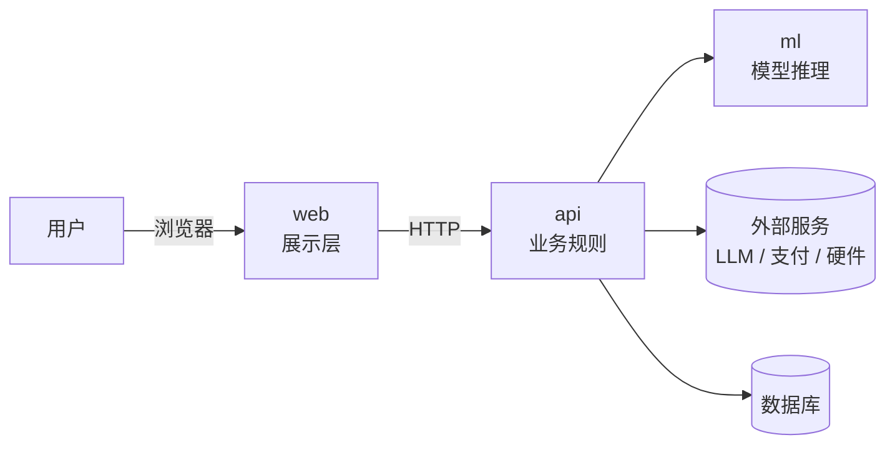

# 项目结构

> 放 `docs/architecture/项目结构.md`。**七段，一段不能少，但都不许超篇幅。**
> 写法见 `references/15-项目结构与提交整理.md` §一–§四。
> **分三次长出来**：A-2 建模块时写 §二 §三 骨架（可全是 `⬜待定`）；S3 每做一次不可逆选型，在 §五 加一条；S5 整理时补 §一 §四 §七。

---

## 一、一句话 + 架构图

**<一句话：给谁，解决什么问题，怎么解决>**



> 图必须能看出**哪块是入口、哪块是逻辑、哪块是外部依赖**。手画 PNG 也行，贴进 `materials/` 再引用。

---

## 二、目录树 + 每层职责

> **只列有职责的层。** 判据：删掉这一行，读的人会不会误解？不列生成物、不列配置文件。
> 每层必须写一句「不放什么」。

```
web/            前端。只做展示和调 API，不放业务规则
  src/pages/    路由级页面，一个文件对应一个 URL
  src/api/      所有后端调用的唯一出口（改接口只改这里）
api/            后端。所有业务规则在这里
  routes/       HTTP 入口，只做参数校验 + 转发，不写逻辑
  services/     业务逻辑，可单测
  adapters/     外部服务（LLM / 支付 / 硬件），换供应商只改这一层
shared/         前后端共享的类型定义，**任何人不得修改**
docs/           见 docs/README.md
```

| 目录 | 职责 | **不放什么** | 谁能改 |
|---|---|---|---|
| `web/` | | | |
| `api/` | | | |
| `shared/` | | | |

---

## 三、技术栈 + 选型理由

> **每条必须带一句代价。没有代价 = 没权衡过。**

| 层 | 用了 | **没用 X，因为 Y** | 代价 / 边界 |
|---|---|---|---|
| 前端 | | | |
| 后端 | | | |
| 数据库 | | | |
| 模型 / 外部服务 | | | |
| 部署 | | | |

---

## 四、主链路（只写一条）

> 写**demo 里要演的那条**。每一步标文件路径和行号。其他分支写进 §七。

**<用户动作> → <最终结果>**

1. `web/src/pages/____.tsx` —— 
2. `api/routes/____.py:__` —— 
3. `api/services/____.py:__` —— 
4. `api/adapters/____.py:__` —— 
5. `shared/schema.py:__` —— 
6. `web/src/pages/____.tsx` —— 

**为什么只走这一条**：

---

## 五、关键设计决策（3 条，含被否决的方案）

> S3 期间每做一次不可逆选择就加一条。**当场记 1 分钟，三天后还原要 20 分钟且会失真。**

### 决策 1：<做了什么>
- **背景**：<当时面对什么约束>
- **否决的方案**：<方案 B> —— 因为 <原因>
- **代价**：<这个选择带来了什么限制>

### 决策 2：

### 决策 3：

---

## 六、怎么跑 + 怎么验

> 命令必须**在干净目录里亲手验证过**（`15` §七）。没验证过的不许写进来。

```bash
# 1. 装依赖

# 2. 配环境（复制 .env.example → .env，需要填的变量）

# 3. 起服务

# 4. 打开 http://localhost:____
```

**验证输出**（贴真实终端输出或截图位置）：

```
<断言 / 测试 / 接口响应的真实输出>
```

---

## 七、已知边界

> **写完这些不会扣分，不写会被追问到扣分。** 冠军队伍的 README 里明写过"真实闭环 failed"。

| 没做 / 没验证 | 影响范围 | 会不会在 demo 里出现 |
|---|---|---|
| | | |
| | | |
| | | |

**会在评委面前承认的一句话版本**：
> "这个我们没做，因为 <原因>；如果多 4 小时，第一件事是 <具体动作>。"
